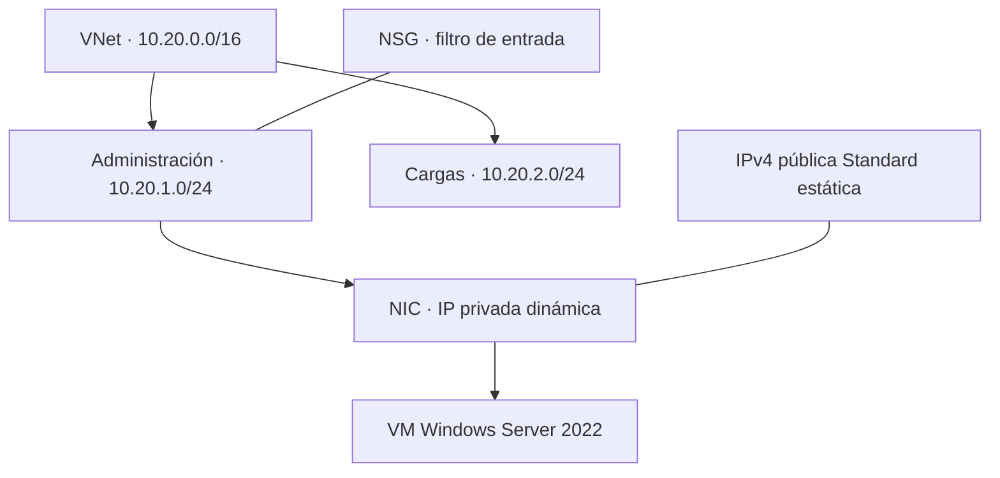

# Laboratorio de red y Windows Server en Azure con Terraform

Una VNet, dos subredes y una VM Windows Server 2022 accesible por RDP desde una única IPv4. El laboratorio reproduce el escenario de Germany West Central y permite cambiar región, tamaño o zona para comprobar cómo se ajustan la red y el cómputo.

## Arquitectura



| Concepto | Cómo se practica |
| --- | --- |
| VNet y subredes | La VNet tiene dos rangos /24 separados. La VM usa la subred de administración y la segunda queda disponible para otras cargas. |
| NIC e IP pública | La configuración de la NIC enlaza el ID de la subred y el ID de la IP pública. Windows usa la IP privada de la NIC y el cliente RDP se conecta a la pública. |
| NSG y asociación | Un recurso independiente asocia el NSG a la subred de administración. La prioridad 100 permite TCP 3389 desde tu /32. La 110 bloquea RDP desde los demás orígenes, incluido el resto de la VNet. |
| Región y zona | VM, NIC, VNet, NSG e IP pública siguen la misma región. Con `vm_zone = null` no se fija zona para la VM. Si eliges zona, la IP pública usa esa misma zona. |
| SKU | `Standard_D2als_v6` es el tamaño de la VM, `2022-Datacenter-g2` identifica la imagen Gen2 y `Standard` es la SKU de la IP pública. Se comprueban por separado. |
| Contraseñas | Terraform valida la longitud y complejidad básica. PowerShell recoge la contraseña sin mostrarla ni escribirla en el historial de comandos. |

El grupo de recursos puede guardar sus metadatos en otra región. La compatibilidad de la NIC con la VNet y la VM depende de la región de esos recursos. Si el tamaño solo está disponible en otra región, despliega allí también la red. Si mueves la VM a la segunda subred de esta VNet, revisa la asociación del NSG antes de conservar el acceso público. Si aplicas además un NSG a la NIC, ambos filtros deben permitir el tráfico entrante. [Procesamiento de tráfico por los NSG](https://learn.microsoft.com/azure/virtual-network/network-security-group-how-it-works)

## 1. Comprueba la suscripción, la región y la SKU

Necesitas Terraform 1.11 o posterior, Azure CLI, PowerShell y permisos para crear los recursos del laboratorio. La VM, su disco y la IP pública pueden generar costes mientras existan.

```powershell
git clone https://github.com/goizmo/terraform-azure-windows-network-lab.git
Set-Location terraform-azure-windows-network-lab

az login
az account set --subscription '<nombre o ID de tu suscripción>'
az account show --query '{suscripcion:name,id:id}' --output table
$env:ARM_SUBSCRIPTION_ID = (az account show --query id -o tsv).Trim()

$region = 'germanywestcentral'
$size = 'Standard_D2als_v6'
az vm list-skus --location $region --resource-type virtualMachines --size $size --all --query "[?name=='$size'].{sku:name,zonas:locationInfo[].zones,restricciones:restrictions}" -o json
az vm list-usage --location $region -o table
az vm image show --location $region --urn MicrosoftWindowsServer:WindowsServer:2022-Datacenter-g2:latest --query '{arquitectura:architecture,generacion:hyperVGeneration}' -o json
```

- **SKU y zona.** Comprueba que aparece el tamaño exacto y que las restricciones de tu suscripción permiten la región y, si la fijas, la zona elegida. `NotAvailableForSubscription` identifica una restricción de la suscripción. Un resultado vacío pide revisar la combinación de región y SKU.
- **Cuota.** Comprueba que quedan vCPU tanto en la cuota regional como en la de la familia del tamaño elegido. Tener cuota y una SKU disponible ayuda a validar la elección. La capacidad en el momento de crear la VM puede variar.
- **Imagen.** Si cambias de tamaño, confirma que admite una imagen x64 de generación 2 y el disco especificado en [compute.tf](compute.tf). Cambia región, tamaño o zona en `terraform.tfvars` y genera un plan nuevo.

[Diagnóstico de SKU y disponibilidad](https://learn.microsoft.com/azure/azure-resource-manager/resource-manager-sku-not-available-errors)

## 2. Configura y despliega

```powershell
Copy-Item terraform.tfvars.example terraform.tfvars
notepad terraform.tfvars
```

Sustituye `203.0.113.10/32` por la IPv4 pública desde la que saldrá tu sesión RDP. Si usas VPN, cuenta la IP de salida de la VPN. Conserva el sufijo `/32`. Usa de 12 a 123 caracteres para la contraseña, con al menos tres grupos entre mayúsculas, minúsculas, números y símbolos. Azure aplica comprobaciones adicionales. [Requisitos de Windows en Azure](https://learn.microsoft.com/azure/virtual-machines/windows/faq)

```powershell
terraform init
terraform validate

$env:TF_VAR_vm_admin_password = [System.Net.NetworkCredential]::new('', (Read-Host 'Contraseña del administrador de Windows' -AsSecureString)).Password
terraform plan -out=lab.tfplan
```

Revisa el plan. Si se generó correctamente y los cambios son los esperados, aplícalo.

```powershell
terraform apply lab.tfplan
Remove-Item Env:TF_VAR_vm_admin_password -ErrorAction SilentlyContinue
terraform output
```

La contraseña de Windows, el inicio de sesión de la CLI y las credenciales de una aplicación de Entra ID cumplen funciones distintas. Este ejemplo usa la sesión interactiva de Azure CLI para administrar Azure. La contraseña de Windows se utiliza dentro de la VM.

`sensitive = true` oculta la contraseña en la salida habitual de Terraform. AzureRM puede guardarla en texto claro dentro del estado y el plan binario puede contener datos sensibles. Mantén ambos archivos locales, con acceso restringido, y conserva el estado hasta terminar la limpieza. [AzureRM Windows VM](https://registry.terraform.io/providers/hashicorp/azurerm/4.81.0/docs/resources/windows_virtual_machine) · [Datos sensibles en Terraform](https://developer.hashicorp.com/terraform/language/manage-sensitive-data)

## 3. Verifica RDP y diagnostica el fallo

```powershell
$ip = terraform output -raw public_ip_address
terraform output -raw rdp_username
Test-NetConnection -ComputerName $ip -Port 3389
mstsc /v:$ip
```

| Resultado | Qué comprobar |
| --- | --- |
| `TcpTestSucceeded : False` | Estado de la VM, IP pública asociada a la NIC, IPv4 desde la que sales, asociación del NSG y firewall de Windows. Revisa que el cliente pueda salir por TCP 3389. |
| RDP llega a la pantalla de autenticación y rechaza la contraseña | Elige **Usar otra cuenta** e introduce el usuario local `.\tfadmin` que devuelve Terraform. Revisa credenciales guardadas, distribución del teclado y la contraseña utilizada al crear la VM. |
| Sigue fallando la cuenta local | En el Portal de Azure, abre la VM y usa **Restablecer contraseña**. Ese cambio en Windows queda fuera de Terraform. Si cambias posteriormente la variable de contraseña, revisa en el plan el efecto sobre la VM antes de aplicar. |
| La conexión deja de funcionar después de cambiar de red | Actualiza `rdp_source_cidr` con tu nueva IPv4 pública y aplica el cambio del NSG. |

[Diagnóstico de RDP](https://learn.microsoft.com/troubleshoot/azure/virtual-machines/windows/troubleshoot-rdp-connection) · [Restablecimiento de RDP y contraseña](https://learn.microsoft.com/troubleshoot/azure/virtual-machines/windows/reset-rdp)

## 4. Elimina los recursos

Desde la misma carpeta, suscripción y configuración del despliegue:

```powershell
$env:TF_VAR_vm_admin_password = [System.Net.NetworkCredential]::new('', (Read-Host 'Contraseña original del laboratorio' -AsSecureString)).Password
terraform destroy
Remove-Item Env:TF_VAR_vm_admin_password -ErrorAction SilentlyContinue
az group exists --name rg-tf-win-network-lab
```

Comprueba que el último comando devuelve `false` tras la destrucción. Cuando ya no necesites el plan, elimina `lab.tfplan`.

## Validación sin Azure

```powershell
terraform init -backend=false
terraform fmt -check -recursive
terraform validate
terraform test
```

Las pruebas simulan el proveedor AzureRM. Comprueban regiones, subredes, una IP Standard estática, coherencia de zona, reglas RDP y el rechazo de una IP abierta o de una contraseña débil. Las comprobaciones de disponibilidad y una conexión RDP real requieren desplegar en una suscripción de Azure.
